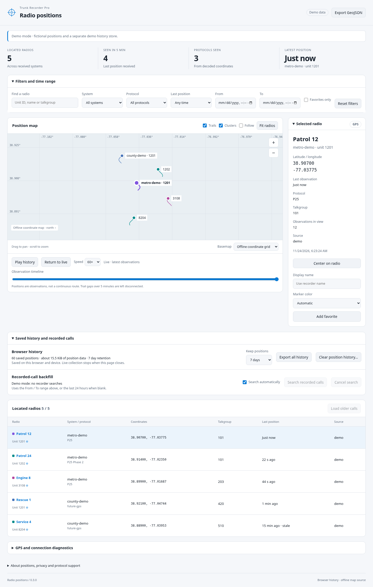

# GPS history plugin for Trunk Recorder Pro

**v0.4.1 is a plugin release. Install it from the Plugins page, not Interfaces.**
The previous browser-only interface remains available at
[v0.3.0](https://github.com/n71fs/trunk-recorder-gps-tracker/releases/tag/v0.3.0).

The plugin saves decoded GPS positions in SQLite **on the recorder machine** and
includes the tracking dashboard. It collects while TR Pro is **Started**, even
with every browser closed. It does not require saving call audio, changing
TR Pro's code, installing Go/SQLite/Node, or running a separate service.

## Install and open

1. In TR Pro, open **Plugins → Install from GitHub…** and enter
   `n71fs/trunk-recorder-gps-tracker`.
2. Enable **GPS history**, then click **Start** in TR Pro if it is not running.
3. Open the plugin's **GPS history** settings/page and click **Open GPS dashboard**.
   The plugin fills in this private dashboard link automatically after starting.

Or install with:

```sh
trunk-pro plugin install n71fs/trunk-recorder-gps-tracker
```

Packages are provided for Linux x86-64, Linux ARM64/Raspberry Pi, universal macOS
(Intel and Apple silicon), and Windows x86-64. They contain a native executable
with the complete dashboard embedded. Release files follow TR Pro's plugin
installer naming, manifest and SHA256SUMS conventions.

**Stop in TR Pro stops the plugin**, including its dashboard server. SQLite
history remains on disk and is available again after the next Start. An already
open dashboard can still show its browser cache, but it cannot query the server
while the plugin is stopped. Audio archiving can stay off throughout.

## Defaults and settings

Most installations work with the defaults:

| Setting | Default | Purpose |
|---|---|---|
| Recorder URL | `http://127.0.0.1:8080` | Change this if TR Pro's own web/API port differs |
| Dashboard bind address | `auto` | Listens on an explicit Dashboard address when set; otherwise follows recorder bind; uses port 8095 or a free port |
| Dashboard address | `auto` | Uses loopback for a local recorder; for a network-facing recorder, prefers a Tailscale address, then a LAN address |
| Keep GPS history | 30 days | Old positions are removed automatically; configurable 1–365 days |
| Maximum saved positions | 1,000,000 | Oldest positions are removed first; configurable 1,000–10,000,000 |
| Backfill recorded GPS | 24 hours | Reads available call metadata when connecting; 0 disables backfill, and searches are capped at 50,000 calls |
| GPS dashboard | Filled automatically | Private read-only dashboard link |

Settings changes restart only this plugin's internal collector/dashboard and
keep its database. A brief collection gap may occur during reconfiguration.
For remote viewing, the recorder must already be configured for network access;
the dashboard uses a separate port, which must be reachable through the firewall.
Set the bind/address fields if auto-detection does not match your network.

The URL carries an unguessable access token in its **fragment** (`#token=…`). It
is not sent to OpenStreetMap or in HTTP referrers. Treat the dashboard link as a
private GPS read-access link and share it only with intended viewers. Keep remote
access on a trusted network/VPN such as Tailscale; this plugin does not add TLS.
The plugin-data folder holds `positions.sqlite` and a persistent `dashboard-token`
file. Back up the database with SQLite-aware tools or while the plugin is stopped.
Do not delete that folder during an upgrade if you want to retain history.

## Dashboard connection troubleshooting

If the plugin is Running but a phone cannot connect, make sure **Dashboard address**
is the recorder machine's reachable IP (for example its Tailscale IP), not the
phone's IP. Starting with v0.4.1, **Dashboard bind address = auto** also listens on
that explicitly selected IP. Reopen the generated link after settings apply.

On v0.4.0, set **Dashboard bind address** explicitly to `RECORDER_IP:8095` as
well as **Dashboard address** to `RECORDER_IP`. The older version could generate
a remote link while listening only on localhost. A manual bind value always
overrides automatic binding.

If the link still cannot connect, check that TCP access to the displayed dashboard
port is allowed by the recorder machine's firewall and any Tailscale access rules.
Being able to open TR Pro on its own port does not establish access to port 8095.
For containers, the dashboard IP must exist inside the container and the dashboard
port must be published; use an explicit bind such as `0.0.0.0:8095` with the host's
reachable IP as Dashboard address. Keep the complete generated link, including its
`#token=…` fragment, when opening it in Safari.

## What is collected

The plugin opens TR Pro's existing WebSocket API and subscribes to decoded
position logs. It also reads available source coordinates from recent/queried
call metadata. Its only recorder commands are **subscribe** and **callsQuery**;
it requests no audio and cannot Start, Stop, or change recorder configuration.
Its regular host-protocol topic list is empty, so it never holds up call file
cleanup and does not require `call.result` acknowledgements.

It works with the GPS output of your `n71fs/trunk-recorder-pro`
`v0.3.9-gps.1` build: Motorola/L3Harris P25 and supported standard DMR/Hytera
embedded GPS including XPT. It does not add HDAP/LP, LRRP or UDT/NMEA decoding.
A plugin cannot save positions the recorder has not decoded. Disconnects,
shutdowns and unsupported formats can leave gaps. Backfill recovers only
coordinates available in retained call metadata, not missing live-only fixes.

SQLite commits use WAL and full synchronization; incoming observations are batched
for up to 250 ms or 100 fixes, and pending writes are drained on normal shutdown.
Only committed records are broadcast to dashboards. Forced termination/power loss
can lose uncommitted buffered fixes. Positions are deduplicated by system, unit,
observation time and coordinates, with stable pagination and separate radio IDs
per system. Live times are approximate when the recorder provides engine seconds
rather than a GPS timestamp. No manufacturer accuracy or exact GPS timestamp is
invented.

## Dashboard and browser cache

The bundled dashboard keeps the map, trails, favorites, colors, playback, GPS
backfill/search, diagnostics, and mobile layout. **Search saved positions** queries
the plugin's machine-wide database. A recorder-machine history panel shows its
count, size and retention. Browser cache controls affect only that browser;
**Clear browser cache** does not delete the plugin's SQLite history. Browser cache
retention and plugin retention are separate settings.

The browser display/search limits are described below. A new browser/device can
query server history without needing an old browser's IndexedDB cache. Open the
plugin's private link, not the old standalone interface URL, to use server history.

## Development and validation

Go 1.24+ is needed only to build from source (releases use Go 1.27.4):

```sh
go test -race ./...
go build -o bin/gps-history .
go build -o bin/mock-recorder ./cmd/mock-recorder
bin/gps-history --describe
npm test
```

`tests/plugin-browser.cjs` tests the real plugin executable against a local mock
recorder: browser-closed collection, authenticated dashboard, fresh-browser
history/playback, no audio files, and shutdown/restart durability. The existing
browser suites also remain. Set `PLAYWRIGHT_MODULE`/`CHROMIUM_EXECUTABLE` as
explained in the interface guide below. Automated map requests are mocked.
Live radio hardware reception has not been tested in this environment.

Third-party runtime/dependency licenses are included in `THIRD_PARTY_NOTICES.txt`.
The plugin's read-only API is documented in [PLUGIN-API.md](PLUGIN-API.md).

---

# Browser interface guide

The following also describes the legacy static interface. Its browser-only
collection limitations do not apply to the running plugin's SQLite collector.

A self-contained GPS tracking interface for Trunk Recorder Pro, made against
the repository's API 1 on `main` (November 2026). Plain HTML, CSS and JavaScript;
no build, runtime dependencies, API keys or recorder changes. OpenStreetMap
street tiles load automatically; an offline coordinate grid remains available.



## Interface features

- IndexedDB history survives reloads on the same browser and device, with
  1/7/30/90-day retention, storage usage, export and clear controls.
- Automatic recorded-call backfill, date/time searches, progress and cancellation.
- Timeline scrubbing and 1×/60×/600× playback using actual observations only.
- Saved map view, selected-radio following, overlapping marker clusters,
  favorites, local display names and consistent/custom marker colors.
- Diagnostics for connection, GPS sources, rejected fixes, unreadable logs,
  adapters, map loading and browser storage.
- Map-first mobile layout with collapsible filters and radio details.

Everything runs within the interface installation. There is no companion
service, backend, plugin, database setup or recorder configuration change.

## Run

Install from GitHub with `n71fs/trunk-recorder-gps-tracker` on the recorder’s
Interfaces page. For a local folder, use **Interfaces → Add a folder…**, then
**Open**. Leave access at **Listen**. Alternatively, for one run:

```sh
trunk-pro --ui /absolute/path/to/trunk-recorder-gps-tracker
```

The `--ui` option gives control access for that run, although this interface
only uses read commands. Files are served directly: edit and reload.

For a fictional preview, add `?demo` to the interface URL. Demo mode opens no
recorder connection and labels every view as demo data. You can also preview it
with `python3 -m http.server 8765` from this folder, then open
`http://localhost:8765/?demo`. The real interface needs the recorder's
`/api/client.js` and `/api/ws` on the same origin.

## What it tracks

- Live `log` messages, subscribed through the recorder's client library, whose
  `kind` is `position`: `Unit 123 at 38.90000, -77.00000 (TG 101)`.
- `history`, `concluded` and requested `callsResult` records with
  `record.srcList[].lat` and `.lon`. Recent history arrives on connection;
  automatic backfill searches the last 24 hours (or your saved From / To range)
  when the recorder advertises call-store support. **Search recorded calls**
  reruns that range and **Load older calls** steps beyond the greeting history.
  Calls without coordinates do not add positions.
- Each radio is keyed by **system short name and unit ID**. Repeated unit IDs
  in different systems stay separate. Late history cannot replace a newer fix.

The original recorder decodes Motorola P25 Phase 1 and L3Harris P25 Phase 1/2
positions (`crates/trunk-core/src/p25/gps.rs`). The `n71fs/trunk-recorder-pro`
`v0.3.9-gps.1` fork adds standard DMR/Hytera embedded GPS including XPT, using
the same output fields. This interface does not decode
radio packets or add support for protocols the recorder cannot decode yet.
Live logs do not expose the manufacturer decoder's `Position.source`, so the
interface labels those fixes with the configured system type. Recorded fixes
use `voice_mode`, falling back to `system_type` or `unknown`.

Live observation times are approximate wall times estimated from engine
seconds and receipt time (including network delay). Recorded positions carry
the source transmission's time, not the exact GPS-fix time. Both are marked
approximate. Five-minute-old positions are labeled **stale**; they are last
known locations, not a guarantee of present location. Trails do not connect
observations separated by more than five minutes. Calls may retain only the latest GPS fix
for a transmission; archived trails cannot reconstruct fixes that were not saved.

## Saved history, searches and playback

Positions are automatically saved to **IndexedDB on this browser and origin**.
Default retention is **7 days**, configurable to 1, 7, 30 or 90 days. At most
100,000 observations are saved; the oldest are removed first. Cleanup runs at
startup, periodically, and when retention changes. Storage usage is the
approximate size of serialized position data (sampled for large histories), not
the browser's total disk use.
The map's in-memory view is bounded to 1,000 radios, 2,000 observations per radio,
and 100,000 observations overall. Export all history includes saved observations
even when they fall outside the current map's display limits.

**Collection stops when the page closes**; mobile browsers may also suspend
background tabs. Reopening restores locally saved fixes and queries retained
call metadata for more. It cannot recover live-only fixes never received or
saved by either browser or recorder. Saving audio is not required, but historical
backfill depends on available call metadata. No decoder or recorder changes are
made. Browser storage can be unavailable, full, evicted or cleared; the page
reports a session-only fallback and continues showing incoming fixes. Export
important history. Very recent buffered writes may not survive browser termination.

The default automatic search covers **24 hours**, or a saved custom range.
Choose **From / To** under Filters and time range, then **Search recorded calls**
for another interval. Searches retain a fixed end time and page through at most
50,000 calls (100 pages), with progress and cancellation. A cancelled or timed-out
request cannot append a late reply. Narrow the range if the safety limit is
reached. Disable **Search automatically** to prevent searches on connection.
Coordinates older than your browser retention period are not saved for a later
visit; choose an appropriate retention period before searching old dates.

The timeline uses observations within the current filter/date range. Scrub or
play at 1×/60×/600× to show the last actual fix at or before the chosen time.
Positions are not interpolated. Long trail gaps are left disconnected, and stale
markers remain labeled. **Return to live** restores the newest view. A selected
radio with no earlier observation stays selected, without fabricating a position.
Playback pauses when the page is hidden. Select **Follow** to keep the selected
radio centered; manual map navigation turns it off. Cluster markers show a count;
click one to zoom in, or use the accessible radio list to select an individual.

**Export GeoJSON** exports visible radios' observations within the chosen time
and playback range. **Export all history** exports both saved and current-session
positions. **Clear position history…** clears browser data and the current map,
never recorder files. New GPS or automatic backfill on reconnect can add data again.
Favorites, display names/colors, filters, collapsed panels, map view and basemap
selection are local browser preferences, separate from retained observations.

The demo uses a **separate history database**, so fictional data never enters
the recorder's saved position history. Radio data is not sent to the map service.

## Diagnostics

The diagnostics panel separates live fixes, recorded fixes and browser-restored
fixes. It shows recorder version/phase, last messages, invalid coordinates,
unreadable position logs, adapter errors and tile status. Calls with no GPS fields
are normal and are not treated as rejected coordinates. The interface cannot tell
whether absent GPS is caused by an unsupported over-air format, a radio not
transmitting location, or reception trouble; it reports only what it receives.

## Map

The built-in Web Mercator coordinate map has pan, zoom, fit, selectable radio
markers, keyboard controls and trails. It works offline, including without map
imagery. Latitude is displayed exactly; polar map positions clamp to Mercator's
85.0511° limit. Use the radio list as the accessible equivalent to canvas markers.

**OpenStreetMap (online)** is the default: streets and place names appear
without setup, an account, payment or an API key. Attribution is always visible
on the map: [© OpenStreetMap contributors](https://www.openstreetmap.org/copyright).
The map data is openly licensed under the **Open Database License (ODbL)**;
it is not license-free. This application's code remains GPL-3.0-or-later.

Street tiles come directly from `https://tile.openstreetmap.org/{z}/{x}/{y}.png`.
They need internet access. The service receives the viewer's IP address, origin,
and tile coordinates identifying the viewed map area; radio IDs, names, and
GPS record payloads are not included in tile requests. Choosing **Offline
coordinate grid** stops new online tile requests. The selection is remembered
when browser storage is available, including across interface upgrades on the
same origin. Position history is saved locally as described above.

The [OSMF tile usage policy](https://operations.osmfoundation.org/policies/tiles/)
applies. The public service is community funded, best effort, and may limit or
block heavy use; it is not a guaranteed unlimited tile hosting service. We
request only the visible viewport, including before any positions arrive, use ordinary browser
HTTP caching and a valid browser referrer, and do not prefetch or offer offline
area downloads. Failed tiles leave the grid and radios usable, with a
**Retry tiles** button for recovery. No repeated automatic retry loop is used.
For high-volume deployments, configure an appropriate provider in `basemaps.js`
and update its attribution in `index.html` before distributing that change.

**Local map tiles** remains available for disconnected deployments. Supply
appropriately licensed XYZ PNG tiles under `tiles/{z}/{x}/{y}.png`, add their
required attribution to `index.html`, and select that basemap. Do not bulk
download the public OSM tile service to populate this folder. Tile data is not
bundled with the release.

## Add a future protocol

If a future recorder decoder emits existing position logs or call source
coordinates, it works automatically. Protocol labels are open strings, with no
allowlist. The model never branches on radio protocol.

If a future API adds another message shape, add an adapter in `adapters.js`:

```js
export const additionalAdapters = [{
  id: "example-future-position",
  read(message, { rec, receivedAt }) {
    // Example only: this message is NOT part of today's recorder API.
    if (message.type !== "exampleFuturePosition") return [];
    return [{
      system: message.shortName, // Stable short name, never a numeric system index
      unit: message.unit,
      lat: message.latitude,   // Numbers, decimal degrees
      lon: message.longitude,
      time: message.unixMs,    // Positive Unix milliseconds, never engine seconds
      protocol: message.protocol, // Any nonempty string
      talkgroup: message.talkgroup,
      origin: "live",
      estimatedTime: false,
    }];
  },
}];
```

Adapters return zero or more fixes. The store validates finite numeric
coordinates and timestamps, orders history, deduplicates identical observations,
and isolates adapter errors. Unknown unrelated messages are ignored. Keep
adapters synchronous; if a future protocol needs a new subscription, add that
topic to `rec.subscribe` in `app.js` once the recorder supports it.

## Upstream reference

Built against [TrunkRecorder/trunk-recorder-pro](https://github.com/TrunkRecorder/trunk-recorder-pro)
at commit `005c75b69c2f566500642d26d2ba2426770d2118`. The browser test fixture in
`tests/fixtures/trunk-client.js` is copied unmodified from that revision’s
`docs/api/client.js`, under the included GPL-3.0-or-later license. Production
imports the client served by your recorder instead.

## Documentation used

- [`docs/api/llms.txt`](https://github.com/TrunkRecorder/trunk-recorder-pro/blob/005c75b69c2f566500642d26d2ba2426770d2118/docs/api/llms.txt): LLM-specific interface guide.
- [`web/src/protocol.ts`](https://github.com/TrunkRecorder/trunk-recorder-pro/blob/005c75b69c2f566500642d26d2ba2426770d2118/web/src/protocol.ts): authoritative wire shapes.
- [`docs/api/README.md`](https://github.com/TrunkRecorder/trunk-recorder-pro/blob/005c75b69c2f566500642d26d2ba2426770d2118/docs/api/README.md) and
  [`docs/api/client.js`](https://github.com/TrunkRecorder/trunk-recorder-pro/blob/005c75b69c2f566500642d26d2ba2426770d2118/docs/api/client.js): API and client library.
- [`docs/interfaces/README.md`](https://github.com/TrunkRecorder/trunk-recorder-pro/blob/005c75b69c2f566500642d26d2ba2426770d2118/docs/interfaces/README.md) and
  [`publishing.md`](https://github.com/TrunkRecorder/trunk-recorder-pro/blob/005c75b69c2f566500642d26d2ba2426770d2118/docs/interfaces/publishing.md): serving and packaging.
- [`docs/developer/ui-style.md`](https://github.com/TrunkRecorder/trunk-recorder-pro/blob/005c75b69c2f566500642d26d2ba2426770d2118/docs/developer/ui-style.md): interface style.
- [`docs/development.md`](https://github.com/TrunkRecorder/trunk-recorder-pro/blob/005c75b69c2f566500642d26d2ba2426770d2118/docs/development.md): project development guide.

## Validate

```sh
npm test
```

Tests cover validation, live and historical ingestion, system identity, future
protocols, ordering, deduplication, retention, export, projection and adapter
isolation. No Rust or WebAssembly build is needed for this standalone interface.

For browser checks, start the static preview server described above, then run:

```sh
node tests/browser-smoke.cjs
node tests/enhancements-smoke.cjs
```

Playwright 1.57.0 must be available in your test environment (`PLAYWRIGHT_MODULE`
may point at its absolute module path). `GPS_PREVIEW_URL` overrides the preview
address. By default tests launch `/usr/bin/chromium`; set `CHROMIUM_EXECUTABLE`
to another path, or `bundled` for Playwright's installed Chromium. Production has
none of these test dependencies.

Checks cover the real recorder client with a simulated WebSocket, real IndexedDB
persistence/retention/caps/clearing, paginated backfill/cancellation, playback,
favorites/colors/names, follow mode, clustering, diagnostics, blocked storage and
quota failures, and phone layout. Map tiles are intercepted locally; automated
tests never contact the public tile service. The release workflow runs both
browser suites before publication. Live hardware reception was not tested.

License: GPL-3.0-or-later, as in Trunk Recorder Pro.
