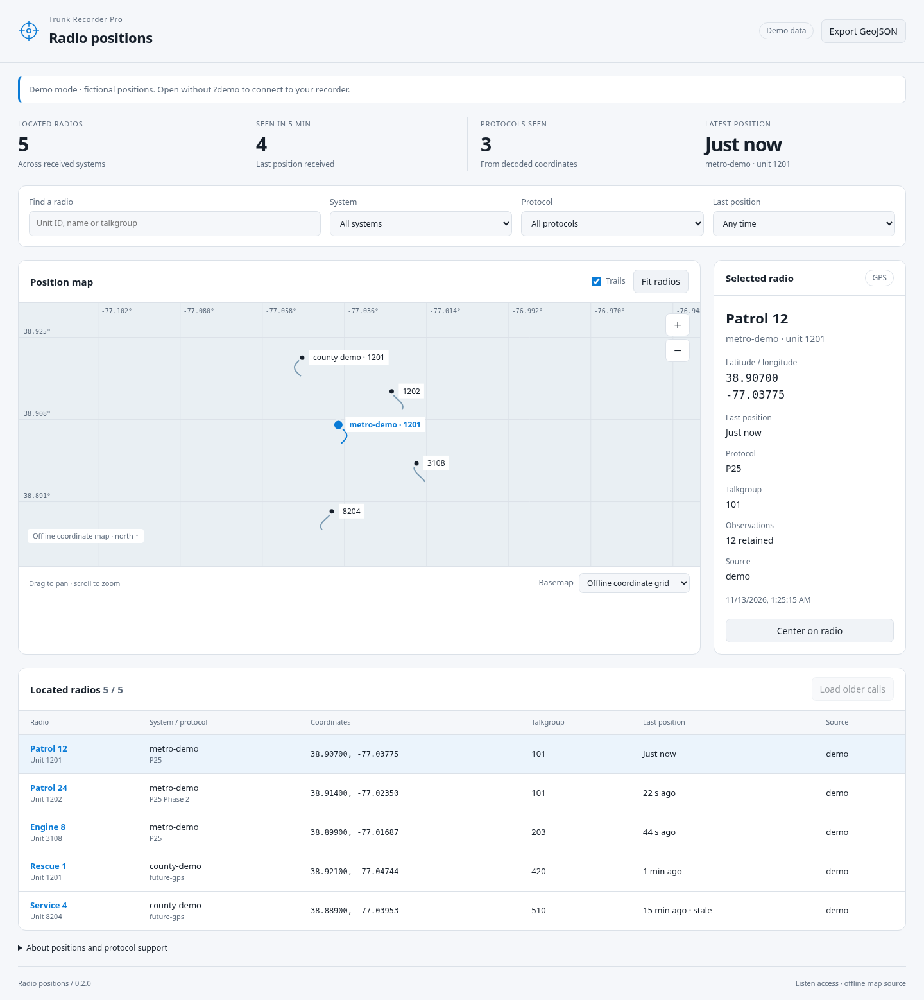

# Radio positions

A self-contained GPS tracking interface for Trunk Recorder Pro, made against
the repository's API 1 on `main` (November 2026). Plain HTML, CSS and JavaScript;
no build, runtime dependencies, API keys or recorder changes. OpenStreetMap
street tiles load automatically; an offline coordinate grid remains available.



## Run

In the recorder's **Interfaces → Add a folder…**, select this folder, then
**Open**. Leave access at **Listen**. Alternatively, for one run:

```sh
trunk-pro --ui /absolute/path/to/trunk-recorder-gps-tracker
```

The `--ui` option gives control access for that run, although this interface
only uses read commands. Files are served directly: edit and reload.

For a fictional preview, add `?demo` to the interface URL. Demo mode opens no
recorder connection and labels every view as demo data. You can also preview it
with `python3 -m http.server 8765` from this folder, then open
`http://localhost:8765/?demo`. The real interface needs the recorder's
`/api/client.js` and `/api/ws` on the same origin.

## What it tracks

- Live `log` messages, subscribed through the recorder's client library, whose
  `kind` is `position`: `Unit 123 at 38.90000, -77.00000 (TG 101)`.
- `history`, `concluded` and requested `callsResult` records with
  `record.srcList[].lat` and `.lon`. Recent history arrives on connection;
  **Load older calls** pages through the call store when available. A page
  without GPS can return no new radios; continue loading to search older calls.
- Each radio is keyed by **system short name and unit ID**. Repeated unit IDs
  in different systems stay separate. Late history cannot replace a newer fix.

The current recorder decodes Motorola P25 Phase 1 and L3Harris P25 Phase 1/2
positions (`crates/trunk-core/src/p25/gps.rs`). This interface does not decode
radio packets or add support for protocols the recorder cannot decode yet.
Live logs do not expose the manufacturer decoder's `Position.source`, so the
interface labels those fixes with the configured system type. Recorded fixes
use `voice_mode`, falling back to `system_type` or `unknown`.

Live observation times are approximate wall times estimated from engine
seconds and receipt time (including network delay). Recorded positions carry
the source transmission's time, not the exact GPS-fix time. Both are marked
approximate. Five-minute-old positions are labeled **stale**; they are last
known locations, not a guarantee of present location. Trails may connect
observations across a long silence. Calls may retain only the latest GPS fix
for a transmission; archived trails cannot reconstruct fixes that were not saved.

The interface keeps up to 1,000 radios and 200 observations per radio in memory.
Reloading clears these observations, then reloads recent recorder history.
**Export GeoJSON** downloads retained observations for radios matching the
current filters (their full retained trails, including older points). Radio
records stay in this tab and are not sent to the map service. Only the basemap
selection is saved in browser storage when available.

## Map

The built-in Web Mercator coordinate map has pan, zoom, fit, selectable radio
markers, keyboard controls and trails. It works offline, including without map
imagery. Latitude is displayed exactly; polar map positions clamp to Mercator's
85.0511° limit. Use the radio list as the accessible equivalent to canvas markers.

**OpenStreetMap (online)** is the default: streets and place names appear
without setup, an account, payment or an API key. Attribution is always visible
on the map: [© OpenStreetMap contributors](https://www.openstreetmap.org/copyright).
The map data is openly licensed under the **Open Database License (ODbL)**;
it is not license-free. This application's code remains GPL-3.0-or-later.

Street tiles come directly from `https://tile.openstreetmap.org/{z}/{x}/{y}.png`.
They need internet access. The service receives the viewer's IP address, origin,
and tile coordinates identifying the viewed map area; radio IDs, names, and
GPS record payloads are not included in tile requests. Choosing **Offline
coordinate grid** stops new online tile requests. The selection is remembered
when browser storage is available, including across interface upgrades on the
same origin. Map coordinates and records are not saved in browser storage.

The [OSMF tile usage policy](https://operations.osmfoundation.org/policies/tiles/)
applies. The public service is community funded, best effort, and may limit or
block heavy use; it is not a guaranteed unlimited tile hosting service. We
request only the visible viewport after positions arrive, use ordinary browser
HTTP caching and a valid browser referrer, and do not prefetch or offer offline
area downloads. Failed tiles leave the grid and radios usable, with a
**Retry tiles** button for recovery. No repeated automatic retry loop is used.
For high-volume deployments, configure an appropriate provider in `basemaps.js`
and update its attribution in `index.html` before distributing that change.

**Local map tiles** remains available for disconnected deployments. Supply
appropriately licensed XYZ PNG tiles under `tiles/{z}/{x}/{y}.png`, add their
required attribution to `index.html`, and select that basemap. Do not bulk
download the public OSM tile service to populate this folder. Tile data is not
bundled with the release.

## Add a future protocol

If a future recorder decoder emits existing position logs or call source
coordinates, it works automatically. Protocol labels are open strings, with no
allowlist. The model never branches on radio protocol.

If a future API adds another message shape, add an adapter in `adapters.js`:

```js
export const additionalAdapters = [{
  id: "example-future-position",
  read(message, { rec, receivedAt }) {
    // Example only: this message is NOT part of today's recorder API.
    if (message.type !== "exampleFuturePosition") return [];
    return [{
      system: message.shortName, // Stable short name, never a numeric system index
      unit: message.unit,
      lat: message.latitude,   // Numbers, decimal degrees
      lon: message.longitude,
      time: message.unixMs,    // Positive Unix milliseconds, never engine seconds
      protocol: message.protocol, // Any nonempty string
      talkgroup: message.talkgroup,
      origin: "live",
      estimatedTime: false,
    }];
  },
}];
```

Adapters return zero or more fixes. The store validates finite numeric
coordinates and timestamps, orders history, deduplicates identical observations,
and isolates adapter errors. Unknown unrelated messages are ignored. Keep
adapters synchronous; if a future protocol needs a new subscription, add that
topic to `rec.subscribe` in `app.js` once the recorder supports it.

## Upstream reference

Built against [TrunkRecorder/trunk-recorder-pro](https://github.com/TrunkRecorder/trunk-recorder-pro)
at commit `005c75b69c2f566500642d26d2ba2426770d2118`. The browser test fixture in
`tests/fixtures/trunk-client.js` is copied unmodified from that revision’s
`docs/api/client.js`, under the included GPL-3.0-or-later license. Production
imports the client served by your recorder instead.

## Documentation used

- [`docs/api/llms.txt`](https://github.com/TrunkRecorder/trunk-recorder-pro/blob/005c75b69c2f566500642d26d2ba2426770d2118/docs/api/llms.txt): LLM-specific interface guide.
- [`web/src/protocol.ts`](https://github.com/TrunkRecorder/trunk-recorder-pro/blob/005c75b69c2f566500642d26d2ba2426770d2118/web/src/protocol.ts): authoritative wire shapes.
- [`docs/api/README.md`](https://github.com/TrunkRecorder/trunk-recorder-pro/blob/005c75b69c2f566500642d26d2ba2426770d2118/docs/api/README.md) and
  [`docs/api/client.js`](https://github.com/TrunkRecorder/trunk-recorder-pro/blob/005c75b69c2f566500642d26d2ba2426770d2118/docs/api/client.js): API and client library.
- [`docs/interfaces/README.md`](https://github.com/TrunkRecorder/trunk-recorder-pro/blob/005c75b69c2f566500642d26d2ba2426770d2118/docs/interfaces/README.md) and
  [`publishing.md`](https://github.com/TrunkRecorder/trunk-recorder-pro/blob/005c75b69c2f566500642d26d2ba2426770d2118/docs/interfaces/publishing.md): serving and packaging.
- [`docs/developer/ui-style.md`](https://github.com/TrunkRecorder/trunk-recorder-pro/blob/005c75b69c2f566500642d26d2ba2426770d2118/docs/developer/ui-style.md): interface style.
- [`docs/development.md`](https://github.com/TrunkRecorder/trunk-recorder-pro/blob/005c75b69c2f566500642d26d2ba2426770d2118/docs/development.md): project development guide.

## Validate

```sh
node --test tests/*.test.js
```

Tests cover validation, live and historical ingestion, system identity, future
protocols, ordering, deduplication, retention, export, projection and adapter
isolation. No Rust or WebAssembly build is needed for this standalone interface.

For the browser smoke test, start the static preview server described above,
then run `node tests/browser-smoke.cjs` with Playwright available in your test
environment (`PLAYWRIGHT_MODULE` may point at its absolute module path).
`GPS_PREVIEW_URL` overrides the local preview address. The test uses the real
project client against a simulated recorder WebSocket; it needs Chromium at
`/usr/bin/chromium`. It checks live GPS, log subscription, history pagination,
filters, export, HTML escaping, basemap switching, caching, attribution, failed
tile fallback, saved preferences, and phone layout. All browser-test map tiles
are intercepted locally; automated tests do not contact the public tile service. Production uses none of these
test dependencies. Live hardware reception was not tested in this environment.

License: GPL-3.0-or-later, as in Trunk Recorder Pro.
